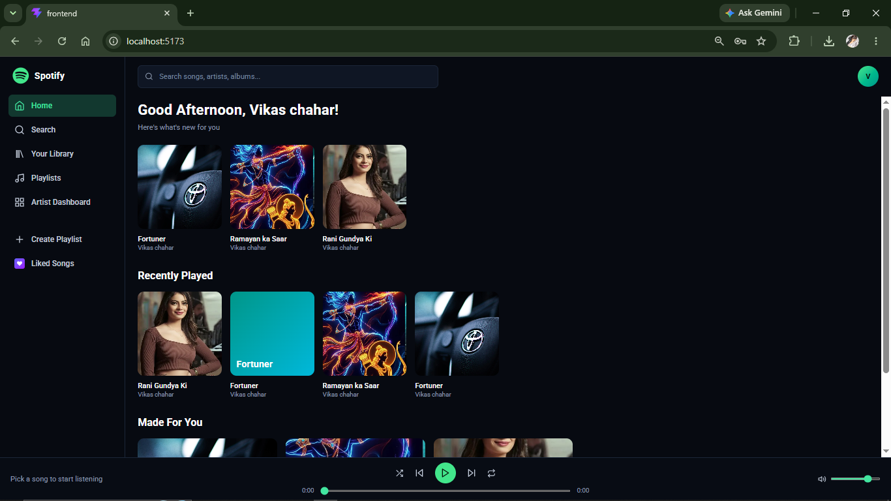
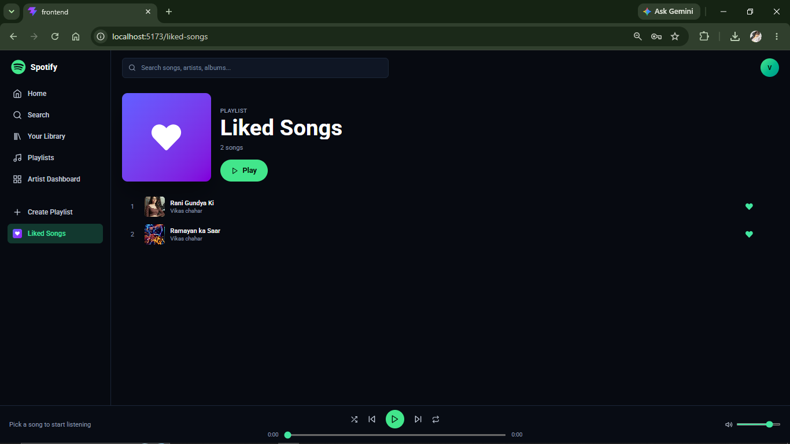
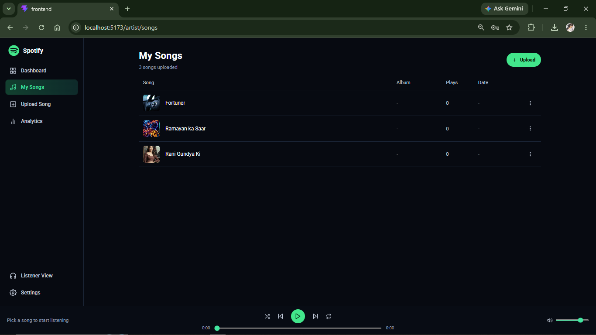
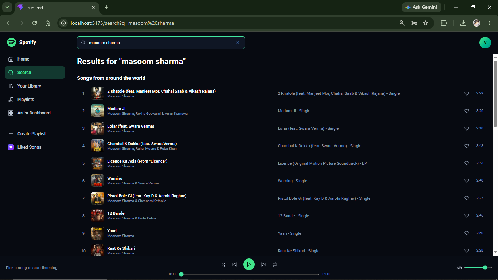
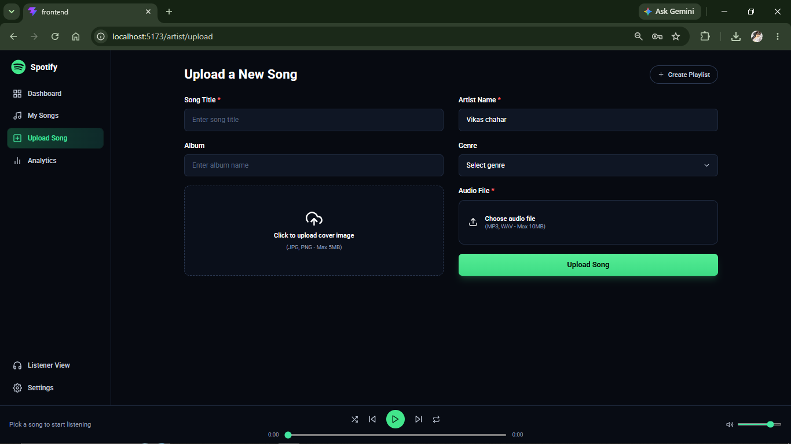

# Full-Stack Spotify Clone (MERN)

A feature-rich, full-stack music streaming web application built with the MERN stack, replicating core Spotify features.

---

## Features

- User Authentication & Roles: Secure signup/login system with role-based access for regular listeners and artists.
- Dynamic Home Page: Browse recommended tracks, albums, and personalized music feeds.
- Artist Dashboard: Dedicated portal for artists to upload new music tracks along with custom cover art.
- Song Management: View all uploaded songs, play/pause controls, and interactive audio playback.
- Liked Songs: Save and manage your favorite tracks for quick access.
- Advanced Search: Easily search for specific songs, artists, or albums in real-time.
- Dual-File Uploads: Backend handling for simultaneous audio and image uploads using Multer.

---

## Tech Stack & Packages

### Frontend
- React.js (Component-based UI)
- Vite (Lightning-fast build tool)
- Tailwind CSS (Modern, responsive styling)
- Redux / Context API (State management for player and UI)

### Backend
- Node.js & Express.js (RESTful API development)
- MongoDB & Mongoose (NoSQL database & schema modeling)
- Multer (Middleware for handling multi-part form data / dual-file uploads)
- JWT & Bcrypt.js (Secure authentication and password hashing)
- CORS & Dotenv (Security and environment configuration)

---

## Project Screenshots

### Login Page

### Artist Dashboard

### Home Page

### Liked Songs

### All Uploaded Songs

### Search Song

### Upload Song

### 🎵 Login Page

### 🎧 Artist Dashboard

### 🏠 Home Page

### ❤️ Liked Songs

### 🎶 All Uploaded Songs

### 🔍 Search Song

### 📁 Upload Song

